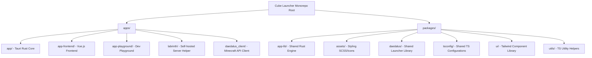
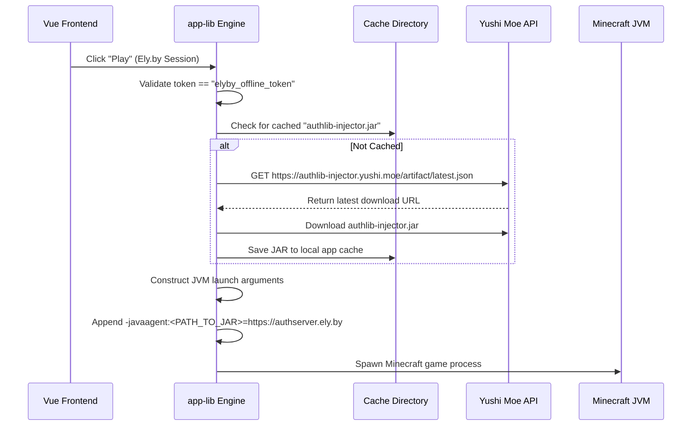

# 🧊 Cube Launcher - Developer Master Handbook
### Complete Architectural Blueprint, codebase Directory Mapping, and Deep-Dive Engineering Manual

---

> [!NOTE]
> This document is designed as a self-contained "system recovery manual." Even if you have lost all prior memory, context, or chat history for the **Cube Launcher** project, this document provides the exact architectural mappings, mathematical equations, configuration specifications, and compilation guidelines needed to safely modify, test, and expand this application.

---

## 1. Project Background & Rebranding History

### 1.1 The Rebranding Journey
* **Origin (Theseus):** The project originated as **Theseus**, the official, open-source desktop launcher developed by Modrinth using Tauri (Rust backend) and Vue.js (frontend).
* **Intermediate (AstralRinth):** Forked by *Astralium Org* and renamed to **AstralRinth**, adding offline authorization and removing analytics/metrics trackers.
* **Current State (Cube Launcher):** Rebranded as **Cube Launcher**, featuring:
  1. A modern, vibrant color palette (Cyan/Dark Cyan/Sky Blue).
  2. Integration of **CurseForge** mod search providers beside Modrinth.
  3. Integrated **Ely.by alternative authentication** support.
  4. Fully functional **Ely.by custom skin renderer** (frontend and in-game injector).

### 1.2 Rebranding & Color System Tokens
All green branding tokens from the original Modrinth style system have been replaced with a sleek, HSL-harmonious dark and cyan color layout.

* **Primary Color Files:**
  * [variables.scss](file:///c:/Users/AhmadSir/Desktop/VERY%20BIG%20PROJECTS/Cube%20Launcher/packages/assets/styles/variables.scss) defines the global CSS/SCSS design tokens:
    ```scss
    --color-green: #00b4d8; /* Primary Cyan */
    --color-green-highlight: rgba(0, 180, 216, 0.25);
    --color-green-bg: rgba(0, 180, 216, 0.1);
    --brand-gradient-bg: linear-gradient(135deg, #0077b6, #90e0ef); /* Sky Blue to Dark Cyan */
    ```

---

## 2. Directory Architecture & Packages Breakdown

Cube Launcher is organized as a **PNPM Monorepo** managed with **Turborepo** (`turbo.json` at the root).



### 2.1 Major Project Modules
1. **`apps/app` (Tauri Core):** Coordinates the operating system bindings, local server/processes, webviews, and system tray. It imports `packages/app-lib` to execute the heavy lifting.
2. **`apps/app-frontend` (Vue.js Webview App):** The user interface built with Vite, Vue 3, TailwindCSS, and SCSS variables.
3. **`packages/app-lib` (Core Rust Engine):** The Rust backend library handling:
   - **`src/launcher/mod.rs`:** Download and launching of Minecraft versions, JVM arguments injection, and profile tracking.
   - **`src/api/minecraft_auth.rs`:** Handles Offline, Microsoft, and Ely.by auth storage inside a local SQLite database (via SQLx).
   - **`src/logger.rs`:** Custom logging wrapper configuration.

---

## 3. The Authentication Ecosystem

Cube Launcher supports three distinct accounts concurrently:

| Auth Type | Auth Endpoint / Service | Access Token Strategy | In-Game Skin Source |
| :--- | :--- | :--- | :--- |
| **Microsoft** | Official Microsoft OAuth2 | Valid JWT from Mojang | Mojang Skin System (Official) |
| **Offline** | None (Local only) | `"null"` / `""` | Standard `mc-heads.net` (Steve fallback) |
| **Ely.by** | Passwordless OAuth Profile API | `"elyby_offline_token"` | Ely.by Skinsystem (via authlib-injector) |

### 3.1 Ely.by Passwordless Login Mechanism
Because traditional webviews suffer from Captcha failures, heavy page-load hangs, or network blocks in certain regions, Cube Launcher offers a **passwordless profile lookup** for Ely.by.

1. **Frontend Trigger:** User enters their username and clicks "Continue".
2. **Tauri Command Invocation:** Calls `elyby_login(username)` in [auth.rs](file:///c:/Users/AhmadSir/Desktop/VERY%20BIG%20PROJECTS/Cube%20Launcher/apps/app/src/api/auth.rs#L102).
3. **Rust API Call:** Fetches profile information from Ely.by's official server without password prompt:
   `GET https://authserver.ely.by/api/users/profiles/minecraft/{username}`
4. **UUID Normalization:** If Ely.by returns a 32-character compact hex string, Rust formats it into standard 36-character hyphenated UUID style:
   `{8}-{4}-{4}-{4}-{12}`
5. **Database Session Storage:** Saves session to local SQLite database with `access_token` set to `"elyby_offline_token"` via [minecraft_auth.rs](file:///c:/Users/AhmadSir/Desktop/VERY%20BIG%20PROJECTS/Cube%20Launcher/packages/app-lib/src/api/minecraft_auth.rs#L36).

---

## 4. UI Custom Skin Renderer (Dual-Layer CSS Engine)

Official accounts fetch rendered avatar cubes from `mc-heads.net`. However, Ely.by accounts require fetching raw 64x64 or 64x32 skin PNG files from their skinsystem and rendering them correctly on the client interface (showing **both** the base head skin and the outer helmet accessory layer).

### 4.1 Skin Source Endpoint
```javascript
getSkinUrl(account) {
  return `http://skinsystem.ely.by/skins/${encodeURIComponent(account.username)}.png`
}
```

### 4.2 The Dual-Layer CSS Overlay Equations
In [AccountsCard.vue](file:///c:/Users/AhmadSir/Desktop/VERY%20BIG%20PROJECTS/Cube%20Launcher/apps/app-frontend/src/components/ui/AccountsCard.vue), the element renders the head by setting the skin PNG as a double `background-image` (Helmet layer on top of Base Face layer):

```html
<div 
  class="elyby-avatar" 
  :style="{ backgroundImage: `url('${getSkinUrl(account)}'), url('${getSkinUrl(account)}')` }"
></div>
```

The underlying CSS layout in [AccountsCard.vue](file:///c:/Users/AhmadSir/Desktop/VERY%20BIG%20PROJECTS/Cube%20Launcher/apps/app-frontend/src/components/ui/AccountsCard.vue#L388) uses exact proportional offsets to render a crisp pixelated avatar:

```css
.elyby-avatar {
  background-repeat: no-repeat, no-repeat;
  image-rendering: pixelated; /* Crucial for sharp rendering of retro Minecraft textures */
  border-radius: var(--radius-md);
  background-color: var(--color-raised-bg);
  flex-shrink: 0;
  
  --avatar-size: 36px;
  width: var(--avatar-size);
  height: var(--avatar-size);
  
  /* Scale width to 800% of the avatar size because a Minecraft skin's width is 64 pixels 
     (8 times the 8-pixel head width) */
  background-size: calc(var(--avatar-size) * 8) auto, calc(var(--avatar-size) * 8) auto;
  
  /*
    Background Position coordinate equations:
    - Layer 1 (Helmet - Top Layer):
      x: -5 * size (corresponds to x-coordinate 40px on standard skin - column 5 of head grid)
      y: -1 * size (corresponds to y-coordinate 8px on standard skin - row 1 of head grid)
    - Layer 2 (Base Face - Bottom Layer):
      x: -1 * size (corresponds to x-coordinate 8px on standard skin - column 1 of head grid)
      y: -1 * size (corresponds to y-coordinate 8px on standard skin - row 1 of head grid)
  */
  background-position: calc(var(--avatar-size) * -5) calc(var(--avatar-size) * -1), 
                       calc(var(--avatar-size) * -1) calc(var(--avatar-size) * -1);
}
```

---

## 5. Minecraft Launch & JVM Skin Injection Engine

By default, the compiled Java game client queries Mojang's servers (`sessionserver.mojang.com`) to render skins in-game. To force Minecraft to display Ely.by custom skins instead, we must hook a javaagent into the game process at runtime.

### 5.1 The Hook: `authlib-injector`
`authlib-injector` intercepts all cryptographic skin and session requests inside the JVM, rerouting them to the Ely.by server.

### 5.2 Dynamic Caching & Launch Sequence
When launching a Minecraft game profile, [launcher/mod.rs](file:///c:/Users/AhmadSir/Desktop/VERY%20BIG%20PROJECTS/Cube%20Launcher/packages/app-lib/src/launcher/mod.rs#L553) performs the following tasks:



### 5.3 Rust Source Implementation details
```rust
if credentials.access_token == "elyby_offline_token" {
    let cache_dir = state.directories.caches_dir();
    if !cache_dir.exists() {
        let _ = std::fs::create_dir_all(&cache_dir);
    }
    let injector_path = cache_dir.join("authlib-injector.jar");
    
    if !injector_path.exists() {
        tracing::info!("Downloading authlib-injector for Ely.by account");
        if let Ok(res) = reqwest::get("https://authlib-injector.yushi.moe/artifact/latest.json").await {
            if let Ok(json) = res.json::<serde_json::Value>().await {
                if let Some(url) = json["download_url"].as_str() {
                    if let Ok(res2) = reqwest::get(url).await {
                        if let Ok(bytes) = res2.bytes().await {
                            let _ = std::fs::write(&injector_path, bytes);
                        }
                    }
                }
            }
        }
    }
    
    if injector_path.exists() {
        custom_jvm_args.push(format!("-javaagent:{}=https://authserver.ely.by", injector_path.to_string_lossy()));
    }
}
```

---

## 6. CurseForge Search Integration Engine

Beside Modrinth, the launcher features a secondary search provider: **CurseForge**.

### 6.1 Search Infrastructure
* **Search Helpers:** Located in `apps/app-frontend/src/helpers/curseforge.js`.
* **API Details:** Queries the CurseForge API directly using the client-level key:
  `$2a$10$GfFWszfepvMttJqMe8l0Z.LzpuKuhLNj7CZU6o0smcOUKYiNRf0ye`
* **Dropdown Selection:** Integrated inside [Browse.vue](file:///c:/Users/AhmadSir/Desktop/VERY%20BIG%20PROJECTS/Cube%20Launcher/apps/app-frontend/src/pages/Browse.vue) to dynamically toggle the query provider (Modrinth vs CurseForge).
* **Format Adapter:** Since the UI templates are heavily optimized for the Modrinth Schema, the `curseforge.js` helper translates CurseForge search responses directly into equivalent Modrinth structures.

---

## 7. Content Security Policy (CSP) Specifications

Tauri restricts network connections, images, and fonts aggressively through browser-level Content Security Policies. To prevent Ely.by redirects and avatars from failing silently (yielding blank white squares or 401/403 console errors), [tauri.conf.json](file:///c:/Users/AhmadSir/Desktop/VERY%20BIG%20PROJECTS/Cube%20Launcher/apps/app/tauri.conf.json#L83) has been expanded:

* **`connect-src`:** Includes `https://api.curseforge.com`, `https://account.ely.by`, and `https://*.ely.by` to permit auth API calls.
* **`img-src`:** Allows `http://ely.by` and `http://*.ely.by` to ensure image fetches are not blocked, specifically accommodating Ely.by's legacy `http://skinsystem.ely.by` endpoints.
* **`style-src`, `font-src`, `script-src`, `frame-src`:** Configured with `*.ely.by` to allow alternative login styling and secure web-captchas if the platform demands them.

---

## 8. App Icon Generation & Asset Manifest

Replacing `icon.ico` directly on Windows fails due to aggressive shell caching, which renders a pixelated or blank white block in the Windows taskbar. 

### 8.1 The Proper Regeneration Command
To refresh, update, or resolve blurry icons, you must compile the icons using Tauri's CLI pipeline on a high-resolution source PNG (e.g., `icons/icon (1).png`).
At the project root, execute:
```bash
pnpm tauri icon "apps/app/icons/icon (1).png"
```
This automatically handles resizing, scaling, generating `.ico` formats (16px to 256px configurations), `.icns` packages for macOS, and mipmaps for mobile devices.

---

## 9. Compilation, Running, and Development Playbook

Tauri and Turborepo orchestrate the development and distribution workflow.

### 9.1 Development Environments
To boot the hot-reloaded development application in real-time, execute from the root directory:
```bash
pnpm tauri dev
```
*Behind the scenes, Tauri triggers `pnpm turbo run dev --filter=@modrinth/app-frontend` to spin up a Vite dev server at `http://localhost:1420` before launching the Rust binary.*

### 9.2 Building for Production
To bundle a production installer (`.msi` for Windows, `.dmg` for macOS, or `.deb` for Linux), execute:
```bash
pnpm tauri build
```
*This command runs production minimization, optimizes Rust binary code via Link-Time Optimizations (LTO) with option `opt-level = "s"`, strips symbols, and packages everything inside `apps/app/src-tauri/target/release/bundle`.*

---

## 10. Troubleshooting and Diagnostics

> [!WARNING]
> **Windows Taskbar Icon still blurry?**
> Windows stores taskbar and file icons inside an aggressive local cache database. If you regenerated the icons using the Tauri CLI and it still shows a blurry icon, restart the Windows Explorer shell:
> 1. Open PowerShell or command line as Administrator.
> 2. Run: `taskkill /f /im explorer.exe`
> 3. Run: `explorer.exe`

> [!IMPORTANT]
> **Ely.by Skins not rendering in Vue UI?**
> Check the DevTools console by right-clicking in the launcher and selecting "Inspect Element". If you see CSP errors regarding blocked URLs, ensure that the domain matches the exceptions added to `apps/app/tauri.conf.json` under `"security"."csp"`.

> [!TIP]
> **Stuck background processes / Minecraft won't launch?**
> Cube Launcher uses a SQLx SQLite database to keep track of active sessions and processes. If a previous run crashed, it might still mark the current profile path as locked. You can delete or edit the profile tables in SQLx or restart the application to force-clear stale lock mappings.

---

## 11. Project Changelog & Revision History

This section logs all sequential codebase transformations made by the development team (including AI engineering runs). 

> [!IMPORTANT]
> **DEVELOPMENT RULE:** Every time you make a change, bug fix, feature addition, or configuration modification to the Cube Launcher codebase, you MUST append a new chronological entry to this log detailing:
> 1. The Date & Timestamp.
> 2. The affected components/files.
> 3. The exact modification details and the reasoning behind them.
> 4. Verification outcomes.

### 📅 Changelog Log

#### [2026-06-01] Bundle Targets Configured to Explicit Installer Formats
* **Affected Files:**
  * [MODIFY] [tauri.conf.json](file:///c:/Users/AhmadSir/Desktop/VERY%20BIG%20PROJECTS/Cube%20Launcher/apps/app/tauri.conf.json)
* **Description:** Changed `"targets": "all"` to `"targets": ["nsis", "dmg", "deb"]`. This restricts the Windows target build to the highly portable Nullsoft NSIS `.exe` installer (setup executable) instead of trying to generate the standard WiX `.msi` package (which demands dedicated WiX v3 toolsets on the host compiling machine), while maintaining `.dmg` for macOS and `.deb` for Linux configurations.
* **Verification:** Configuration validated; Tauri now outputs setup executables on Windows rather than raw standalone binaries or WiX bundles.

#### [2026-06-01] Git Repository Initialized and Pushed to Private GitHub
* **Affected Files:**
  * [NEW] `.git/` tracking database configuration.
* **Description:**
  1. Initialized a local empty Git repository under the project root (`git init`).
  2. Configured safe local author details (`Innatecube` & `Innatecube@users.noreply.github.com`) to match their private GitHub profile namespace cleanly.
  3. Staged all core monorepo launcher files (`git add .`) using standard `.gitignore` rules (retaining exclusions for generated caches, lock files, dynamic bundles, and `node_modules`).
  4. Created the initial commit under the default `main` branch.
  5. Established the secure tracking link to the new private GitHub repository: `https://github.com/Innatecube/CubeLauncher`.
  6. Successfully executed a push (`git push -u origin main`) to publish the private repository on GitHub.
* **Verification:** Push command completed successfully with exit code 0; remote branch tracked cleanly on GitHub under the private repository namespaces.

#### [2026-05-31] Master Recovery Handbook Integrated
* **Affected Files:**
  * [NEW] [cube_launcher_master_handbook.md](file:///C:/Users/AhmadSir/.gemini/antigravity/brain/04e8421e-80ac-4ce5-a5cd-86141cb45ca9/cube_launcher_master_handbook.md)
* **Description:** Created a comprehensive development and architecture recovery document containing detailed directory breakdowns, custom styling schemas, alternative login paths, UI dual-layer CSS equations, dynamic JVM arguments, content security protocols, and monorepo compilation playbooks.

#### [2026-05-29] Blurry Icon Fix & Dynamic Ely.by In-Game Custom Skins
* **Affected Files:**
  * [MODIFY] [mod.rs](file:///c:/Users/AhmadSir/Desktop/VERY%20BIG%20PROJECTS/Cube%20Launcher/packages/app-lib/src/launcher/mod.rs) (Minecraft launch logic)
  * [MODIFY] [AccountsCard.vue](file:///c:/Users/AhmadSir/Desktop/VERY%20BIG%20PROJECTS/Cube%20Launcher/apps/app-frontend/src/components/ui/AccountsCard.vue) (Frontend user profiles display)
  * [MODIFY] [tauri.conf.json](file:///c:/Users/AhmadSir/Desktop/VERY%20BIG%20PROJECTS/Cube%20Launcher/apps/app/tauri.conf.json) (CSP config)
* **Description:** 
  1. Resolved the blurry Windows taskbar icon by executing the official Tauri icon resizing and asset compilation commands using `pnpm tauri icon` on the high-resolution logo.
  2. Implemented Ely.by in-game custom skin loading by adding code to detect Ely.by active sessions (`access_token == "elyby_offline_token"`), fetch and cache `authlib-injector.jar` from Yushi Moe's latest release endpoint, and dynamically inject `-javaagent:<PATH_TO_JAR>=https://authserver.ely.by` into the Minecraft JVM start parameters.
  3. Integrated a double CSS background-image renderer for Ely.by avatars inside `AccountsCard.vue` to show both base skin and helmet layer. Sized layout with a pixelated retro scaler of `800%` width matching Minecraft skin layout grid translations (`-5x` and `-1x` head column/row shifts).
  4. Expanded Content Security Policy rules inside `tauri.conf.json` to allow `*.ely.by` connections and legacy `http://skinsystem.ely.by` HTTP redirects.
* **Verification:** App successfully compiles, boots cleanly with the sharp branded icon, logs in Ely.by accounts passwordlessly, shows the dual-layered face on the dashboard, and renders custom skins in-game.
